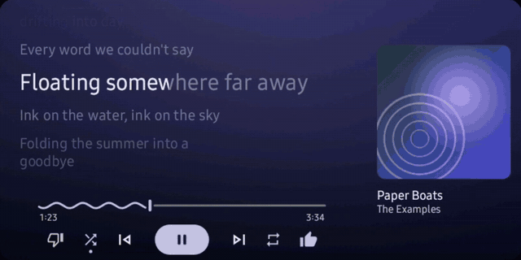
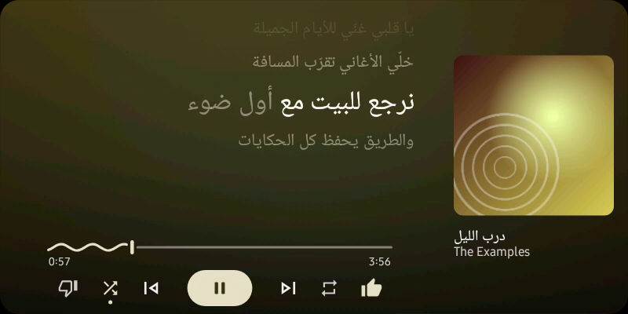
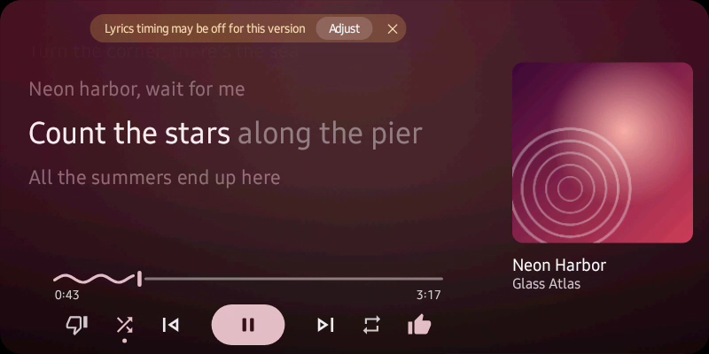

<p align="center"></p>

<h1 align="center">7x Lyrics</h1>
<p align="center"><b>by <a href="https://7xdevs.com">7X Devs</a></b></p>

<p align="center">
  <a href="../../releases/latest"></a>
  <a href="../../releases"></a>
  <a href="LICENSE"></a>
  
</p>

<p align="center">
  <a href="../../releases/latest"><b>⬇ Download the APK</b></a> &nbsp;·&nbsp;
  <a href="https://apps.obtainium.imranr.dev/redirect?r=obtainium://add/https://github.com/c9hama/7x-Lyrics"><b>Get updates with Obtainium</b></a>
</p>

**Full-screen, time-synced lyrics for YouTube Music on your Android Auto car screen.**
See lyrics in your car while you drive: an Android Auto lyrics app that follows YouTube Music,
with karaoke-style highlighting and Arabic and Kurdish (right-to-left) support.

The line being sung is big and bright, the lines around it fade into the colours of the album
cover, and the whole thing scrolls in time with the song. Touch a line to jump there.



> Screenshots and the animation use made-up demo songs and generated cover art (the app's debug-only demo mode),
> so no real lyrics or artwork live in this repository.

---

## Features

### Made for the car screen
- **Lyrics first.** On wide screens the lyrics take the left 70% at full height; the album art,
  title and artist sit in the right 30%.
- **Smooth, readable scrolling.** The current line is large and bright, neighbours shrink and
  fade, and lines ease into place instead of jumping.
- **Colours from every cover.** The play button, progress wave and lyric tint pick up the album's
  main colour, behind a soft blurred (optionally slowly drifting) copy of the cover.
- **YouTube Music-style controls.** Dislike, shuffle, previous, play/pause, next, repeat
  (off / all / one) and like. They press YouTube Music's own buttons, so likes and modes are
  saved there.
- **Wavy progress bar** like YouTube Music's; tap anywhere on it to seek.

### Touch the lyrics
- **Drag** to read ahead or back (flick to glide); the view returns to the sung line after a few seconds.
- **Tap any line** to jump the song to it.

### Right-to-left songs
Arabic, Kurdish and other right-to-left lyrics align to the right and the optional karaoke
highlight fills from the right.



### Lyrics from four places, best first
1. **Your own synced lyrics** (see tap-to-sync below), always used first.
2. **YouTube Music's own synced lyrics**, timed to the exact recording you're playing.
3. **[LRCLIB](https://lrclib.net)**, the open lyrics database.
4. **[LyricsTranslate](https://lyricstranslate.com)** as a last resort for unsynced text, strong
   for Kurdish songs (found via public artist pages only).

The next 5 songs in your queue are fetched ahead, so lyrics keep working in tunnels and dead zones.

### Fix timing in seconds
- **Tap-to-sync** (phone app): for songs nobody has synced lyrics for. The text is pre-filled when
  any source has it (or paste a LyricsTranslate link); press Start and tap once as each line begins.
  A **Music break** button marks instrumental parts. Saved on the phone for good.
- **Per-song nudge** (car screen): lyrics a beat early or late? Shift them in half-second steps;
  remembered for that song. A warning appears when the playing version's length doesn't match the
  lyrics' timing.



### Little things
- ♪ during intros and instrumental breaks, detected automatically when the lyrics don't mark them.
- Optional **karaoke highlight** that sweeps across the current line.
- Lyrics size and moving/still background, set from the phone app.
- Keeps working with the phone locked; respects Android's "Remove animations".

---

## Install

1. **Download** the latest APK from [Releases](../../releases) and install it on your phone
   (or add the repo to [Obtainium](https://github.com/ImranR98/Obtainium) for automatic updates).
2. Open **7x Lyrics** and tap **Grant notification access** (used only to see what YouTube Music is playing).
3. **Important:** scroll down and tap **Install for Android Auto**, then **Update**.
   Repeat this after every install or update, otherwise your car hides the app.
4. Android Auto settings → tap **Version** about 10 times → ⋮ → **Developer settings** → turn on **Unknown sources**.
5. Reconnect to the car and open **7x Lyrics** from the app grid.

## How it works

- **Now playing:** reads YouTube Music's media session (title, artist, position, controls)
  through notification access.
- **Car screen:** real cars hide sideloaded Car App Library apps, so the car screen runs as a legacy
  Android Auto projection app using the unreleased Android Auto SDK (the same approach as
  [Fermata Auto](https://github.com/AndreyPavlenko/Fermata)), drawing every frame itself on a surface.
- **"Install for Android Auto"** reinstalls the app's own APK through Android's package installer
  with the Play Store recorded as installer, the method AAAD uses, which is what real cars check.

## Build

```sh
tools/fetch-aauto.sh        # downloads the Android Auto SDK (aauto.aar), not stored in git
./gradlew assembleRelease   # app/build/outputs/apk/release/app-release.apk
```

Test without a car using Google's Desktop Head Unit at the car's resolution:

```sh
adb forward tcp:5277 tcp:5277
~/Library/Android/sdk/extras/google/auto/desktop-head-unit -c tools/dhu/car_800x480.ini
```

The DHU allows sideloaded apps that real cars hide, so always confirm in the car.

### Code map

| Path | What |
| --- | --- |
| `source/` | Follows the player's media session, queue and custom actions |
| `lyrics/` | Sources (YouTube Music, LRCLIB, LyricsTranslate), matching, LRC parsing, caching, break detection |
| `LyricsEngine.kt` | Picks the current line, per-song timing, download-ahead |
| `car/LyricsRenderer.kt` | Draws the whole car screen |
| `car/legacy/` | Legacy Android Auto entry point used in real cars |
| `SyncEditorActivity.kt` | Tap-to-sync editor |
| `car/DemoMode.kt` | Debug-only demo songs for screenshots |

---

## Contributing

Bug reports, missing-lyrics reports and ideas are welcome in [Issues](../../issues) and
[Discussions](../../discussions). Pull requests too; please open an issue first for bigger changes.

## License

[GPL-3.0](LICENSE). The Android Auto SDK (`aauto.aar`) is not part of this repository and keeps its own terms.

---

Made by **[7X Devs](https://7xdevs.com)** · support@7xdevs.com

Not affiliated with Google, YouTube or any lyrics provider. YouTube Music
lyrics come from an unofficial API and the Android Auto SDK is unreleased, so updates on their
side can break either.
